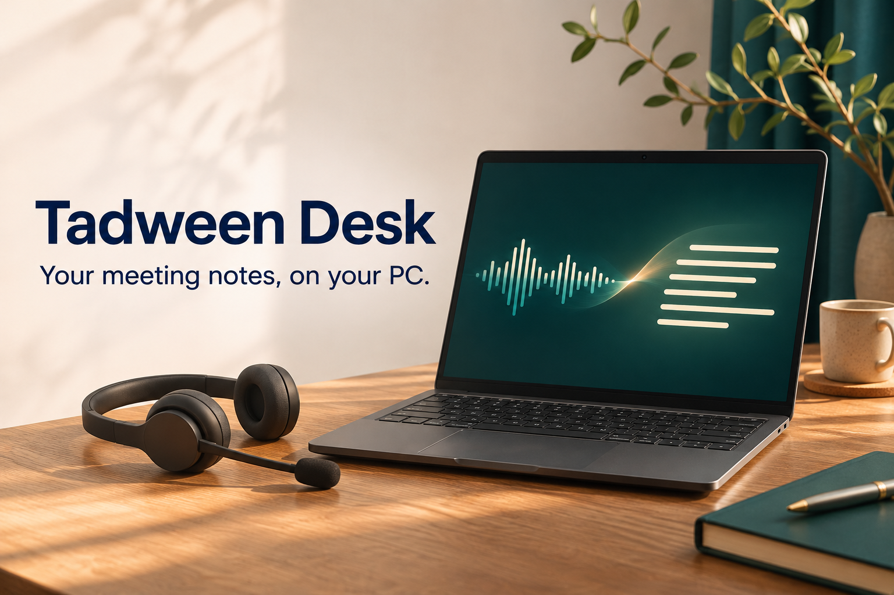
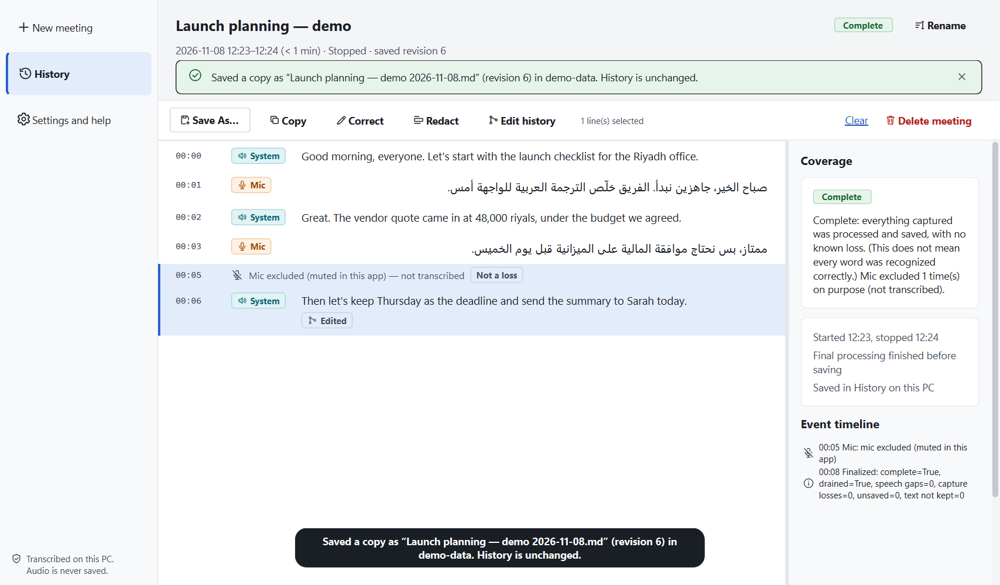

# Tadween Desk | تدوين

**Your meeting notes, on your PC.**



Tadween Desk is a Windows desktop app that writes a live transcript of your meetings in
English and Arabic. Live transcription runs on your PC, and the app does not save or upload
meeting audio. You can correct the transcript later, export it as a text or Markdown file,
and optionally draft meeting minutes with OpenAI when you choose to.

*Tadween* (تدوين) is Arabic for "writing things down".


> **Status: early source release.** It targets Windows 10/11 (64-bit) and has been tested on
> Windows 11. You run it from source with Python; there is no installer or program file. See
> [Current limits](#current-limits) before relying on it.

## What it does

- **Live English and Arabic transcription.** Tadween Desk listens to two sources at once:
  your **microphone** and your PC's **system audio** (what Teams, Zoom, Meet or any other app
  plays through the output you pick). It transcribes both, keeps Arabic in Arabic script and
  handles meetings that switch between the two languages.
- **Mic mute while system audio continues.** **Mute mic** (or `Ctrl+M`) excludes the
  selected microphone source from transcription. Pending mic audio is discarded before it
  reaches speech recognition. The other participants (system audio) keep being transcribed,
  and the transcript shows exactly when the mic was excluded. This only affects Tadween Desk;
  it does not mute you in your meeting app. Your voice can still reach system audio through
  sidetone, mic monitoring ("Listen to this device") or echo from speakers, so use **Pause
  all** when both sources need to stop, and prefer headphones.
- **Editable History.** Every meeting is saved automatically on your PC as it happens. Open
  it later from **History** to search it, rename it, correct a line (the original recognition
  stays in the line's edit history), redact text or delete the meeting. You can choose how
  long History keeps meetings.
- **Save As TXT or Markdown.** **Save As…** writes the current saved version of the
  transcript to a `.txt` or `.md` file wherever you choose.
- **Optional AI minutes.** If you add your own OpenAI API key, **Generate MoM** drafts
  minutes and action items from a saved transcript, with links back to the lines they came
  from. This is the only feature that sends anything off your PC; see [Privacy](#privacy).

| Live transcript | Saved transcript |
|---|---|
|  |  |

*Screenshots of the real app with a fictional demo meeting (rendered by
`app/scripts/demo_screenshots.py` with synthetic audio devices and a scripted recognizer).*

## Privacy

- **Live transcription runs on your PC, and the app does not save or upload meeting
  audio.** Speech recognition (Qwen3-ASR 0.6B, run by a local
  [llama.cpp](https://github.com/ggml-org/llama.cpp) server that only listens on
  `127.0.0.1`) and voice detection (Silero VAD) run on your CPU.
- **No audio at rest.** The app does not write recordings or temporary audio files. Audio
  waits in small, bounded memory buffers until it is transcribed.
- **Your transcripts stay local.** History is a SQLite database in
  `%LOCALAPPDATA%\MeetingMinutes` (the app's internal name). It is not encrypted by the app,
  so protect your Windows account and disk (for example with BitLocker).
- **OpenAI minutes are opt-in and on demand.** Nothing is sent unless you save an OpenAI API
  key *and* press **Generate MoM** for a meeting. If you choose Generate MoM, the app sends
  the selected meeting's saved transcript and related details to OpenAI, including the
  title, date, time zone, line timestamps, source labels and gap or recognition markers.
  Audio is never sent. The request asks OpenAI not to store the response
  (`store: false`); OpenAI's own data policies still apply. Your key is kept in Windows
  Credential Manager, not in the app's files. Before sending, the app shows its own cost
  estimate (not an OpenAI bill), and an app-side limit on that estimate (default US$1.00 per
  generation) blocks larger requests.
- **No telemetry and no automatic updates.**

## Quick start (Windows, from a fresh clone)

You need:

- Windows 10 or 11, 64-bit, with about 3 GB of free disk space (the Python environment
  and 1.1 GB of models);
- [Python 3.11](https://www.python.org/downloads/windows/) (64-bit) with the `py` launcher.
  The dependency locks are made for 3.11 only;
- [Git](https://git-scm.com/download/win), or download the repository as a ZIP;
- internet access for the setup steps only. After setup, the app runs offline.

Run these in PowerShell:

```powershell
git clone https://github.com/muhammedts/tadween-desk.git
cd tadween-desk

# 1. Python environment in app\.venv, from the hash-locked dependency lists (downloads from PyPI)
powershell -ExecutionPolicy Bypass -File app\scripts\bootstrap.ps1

# 2. Speech models into app\models: shows the size (about 1.04 GB) and destination, asks,
#    then checks every file's size and SHA-256. Files that already match are skipped.
.\"Install Models.cmd"

# 3. Start the app
.\"Start Tadween Desk.cmd"
```

On a slow connection, a download can time out; run the same command again. The bootstrap
reuses what pip already downloaded, and the model installer resumes partial downloads
(with Windows' built-in `curl.exe`).
You can also double-click `Install Models.cmd` and `Start Tadween Desk.cmd` in Explorer.
If the app does not open, use `Start Tadween Desk (troubleshooting).cmd`, which keeps a
console window open with any error.

In the app, choose your microphone and the output you hear the meeting on, then press
**Start**. Headphones give the best results: with speakers, your microphone also picks up
the other participants.

### What `Install Models.cmd` installs

All sources and versions are pinned in [`app/models/manifest.json`](app/models/manifest.json)
(each file's URL, revision, byte size and SHA-256). The release archive is listed in
[`app/models/acquisition.json`](app/models/acquisition.json).

| Asset | Source | Download | Licence |
|---|---|---|---|
| Qwen3-ASR 0.6B, Q8_0 GGUF + audio projector | [ggml-org/Qwen3-ASR-0.6B-GGUF](https://huggingface.co/ggml-org/Qwen3-ASR-0.6B-GGUF) @ `928ab95` | 1.02 GB | Apache-2.0 |
| llama.cpp b11960 `llama-server`, Windows x64 CPU | [ggml-org/llama.cpp release b11960](https://github.com/ggml-org/llama.cpp/releases/tag/b11960) | 24 MB zip | MIT |
| Silero VAD (ONNX) | [k2-fsa/sherpa-onnx `asr-models`](https://github.com/k2-fsa/sherpa-onnx/releases/tag/asr-models) | 0.6 MB | MIT |

Options:

```powershell
.\"Install Models.cmd" -DryRun                 # only show what is installed and what would be downloaded
.\"Install Models.cmd" -From D:\my-downloads   # use files you downloaded yourself (checked the same way)
```

**Placing the files by hand.** Download the files listed in the manifest (the `source_url`
of each entry with role `stt`, `vad`, and the llama.cpp zip) into one folder, then run
`Install Models.cmd -From <that folder>`. The installer verifies them and puts each in place.
You can also copy them yourself. The app expects:

```text
app\models\stt\qwen3-asr-0.6b-q8\Qwen3-ASR-0.6B-Q8_0.gguf
app\models\stt\qwen3-asr-0.6b-q8\mmproj-Qwen3-ASR-0.6B-Q8_0.gguf
app\models\runtime\llama.cpp-b11960-win-cpu-x64\  (every file the manifest lists for this entry, from the zip)
app\models\vad\silero_vad.onnx
```

Run `Install Models.cmd` again afterwards: it only checks files that are already in place.
Before the speech engine first starts in a session, the app itself checks every file's size
and SHA-256. A missing or changed file stops it with a setup message; the app never
downloads anything itself. `llama-server` needs the Microsoft Visual C++ runtime. If
Windows does not have it, the installer copies it next to `llama-server` from the PySide6
package in `app\.venv`. Otherwise, install the "Microsoft Visual C++ Redistributable
2015–2022 (x64)".

### Check the setup

From the `app` folder:

```powershell
.\.venv\Scripts\python.exe -m meeting_minutes app --check     # starts the speech engine offscreen with synthetic devices, then stops it
.\.venv\Scripts\python.exe -m meeting_minutes doctor --no-capture
.\.venv\Scripts\python.exe -m pytest                           # developer tests; no network, no audio devices
```

## Optional: AI minutes with OpenAI

1. Open **Settings and help**, find **OpenAI minutes (optional)** and paste your OpenAI API
   key. Saving the key makes no request.
2. Optionally set the minutes language and the spending limit. If you change the model,
   also enter its prices: the app knows only the default model's prices, and without
   prices it cannot estimate the cost and refuses to send while a limit is set.
3. Open a saved meeting in History and press **Generate MoM**. Check the estimate, then
   confirm.

Minutes are **drafts** until you approve them. Each point links to the transcript lines it
is based on, unknown owners and dates stay empty instead of being guessed, and you can edit
them; an export says whether it is a draft. Correcting the transcript marks the minutes as
out of date; redacting text or deleting the meeting removes them.

## Current limits

- **Windows only**, 64-bit, CPU only (no GPU acceleration). Text appears a short delay after
  speech; in a 5-minute two-source test on the one laptop tested (AMD Ryzen 7 5800U,
  Windows 11) the median was about 1.2 seconds. Slower PCs fall further behind.
- **Recognition is not perfect.** English is good on clear audio. Arabic is noticeably less
  accurate, especially for dialects, names and noisy or overlapping speech. Lines the model
  is unsure about are marked, but always review the transcript before you rely on it.
- **"Mic" and "System" are sources, not speakers.** There is no speaker identification:
  everyone on the call appears as System.
- **No echo cancellation.** With speakers instead of headphones, the same speech can be
  transcribed from both sources.
- **Source-only release.** There is no installer, program file (EXE) or auto-update; you
  start the app with `Start Tadween Desk.cmd`.
- Tested by the developer on one Windows 11 laptop. Windows 10, other PCs, screen readers,
  high-DPI setups and most audio devices have not been checked yet.
- The interface is in English (transcripts can be Arabic or English).

## Contributing and reporting issues

See [CONTRIBUTING.md](CONTRIBUTING.md). **Never attach recordings, transcripts, meeting
databases or API keys to an issue.** Describe the problem, and include the output of
`.\.venv\Scripts\python.exe -m meeting_minutes doctor --no-capture` (run in `app\`), which
contains no meeting content.

## Licence

Tadween Desk's own code is released under the [MIT License](LICENSE). It depends on
third-party software and models under their own licences, including Qt for Python (PySide6,
LGPL-3.0), Qwen3-ASR (Apache-2.0), llama.cpp (MIT) and Silero VAD (MIT). See
[THIRD_PARTY_NOTICES.md](THIRD_PARTY_NOTICES.md). Model weights are not part of this
repository; `Install Models.cmd` downloads them from their publishers.
